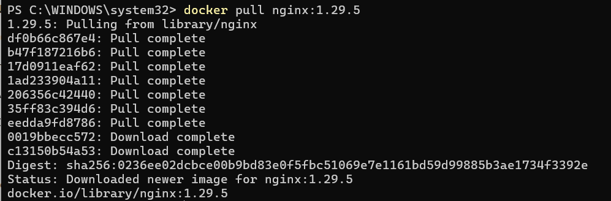
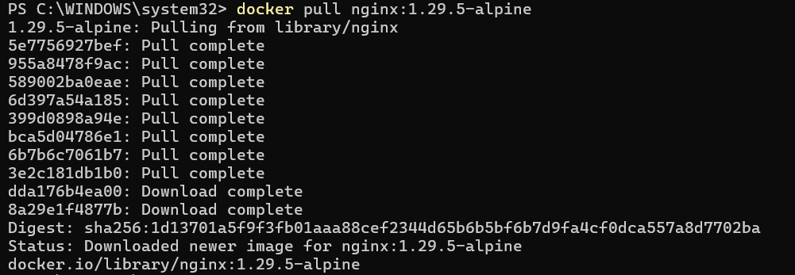
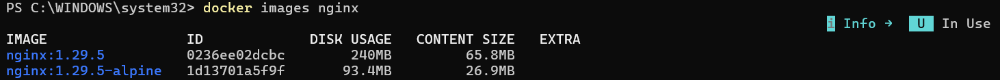
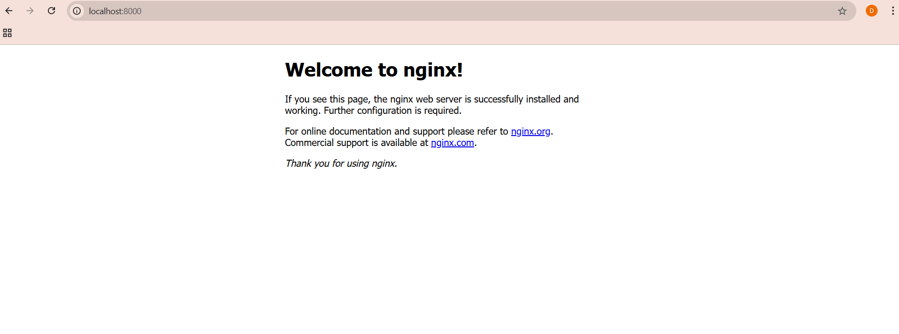
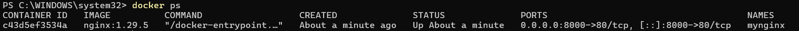
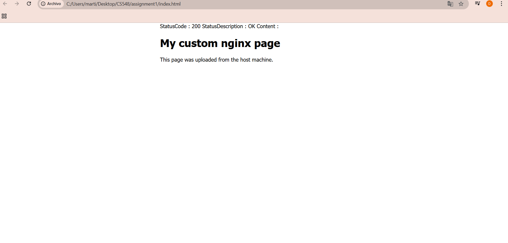
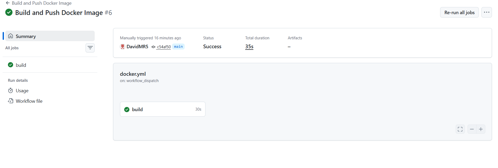

# Assignment 1 – Docker

CS-548: Cloud-native Software Architectures
Computer Science Department – University of Crete

---

# 1. Nginx Container

## Download the images

The following commands were used to download the required images of Nginx from Docker Hub.

```bash
docker pull nginx:1.29.5
docker pull nginx:1.29.5-alpine
```

Example result:




---

## Compare the image sizes

To compare the sizes of the downloaded images:

```bash
docker images nginx
```

Example output:




The **alpine version** is smaller because it is based on Alpine Linux, a minimal Linux distribution.

---

## Start the container in the background

The container was started with port forwarding from port **8000 on the host** to port **80 in the container**.

```bash
docker run -d --name mynginx -p 8000:80 nginx:1.29.5
```

---

## Verify that the server responds

The server was tested with:

```bash
curl http://localhost:8000
```

The response returned the default Nginx page:

```
Welcome to nginx!
```



---

## Confirm the container is running

```bash
docker ps
```

Example output:




---

## Get the logs of the container

```bash
docker logs mynginx
```

This command shows the HTTP requests handled by the Nginx server.

---

## Stop the container

```bash
docker stop mynginx
```

---

## Start the stopped container

```bash
docker start mynginx
```

---

## Stop and remove the container

```bash
docker stop mynginx
docker rm mynginx
```

---

# 2. Modifying the Nginx Container

## Start the container again

```bash
docker run -d --name mynginx -p 8000:80 nginx:1.29.5
```

---

## Open a shell session inside the container

```bash
docker exec -it mynginx /bin/bash
```

---

## Modify the default page

The default page is located at:

```
/usr/share/nginx/html/index.html
```

The first sentence was changed from:

```
Welcome to nginx!
```

to:

```
Welcome to MY nginx!
```

---

## Validate the change

```bash
curl http://localhost:8000
```

The output confirms the modification:

```
Welcome to MY nginx!
```


---

## Download the page locally

```bash
curl http://localhost:8000 -o index.html
```

---

## Upload a new page

The local file was modified with the following content:

```html
<h1>My custom nginx page</h1>
<p>This page was uploaded from the host machine.</p>
```

The file was copied into the container:

```bash
docker cp index.html mynginx:/usr/share/nginx/html/index.html
```

Validation:

```bash
curl http://localhost:8000
```

---

## Delete the container and start a new one

```bash
docker stop mynginx
docker rm mynginx
docker run -d --name mynginx -p 8000:80 nginx:1.29.5
```

The default page appears again.

### Explanation

Containers are **ephemeral**, meaning that all changes inside the container are lost when the container is removed.

---

## Serve a page from a local folder

Create a simple HTML page:

```html
<h1>My custom nginx page</h1>
<p>This page was uploaded from the host machine.</p>
```

Run Nginx using a bind mount:

```bash
docker run -d -p 8000:80 -v ${PWD}:/usr/share/nginx/html nginx:1.29.5
```

Opening:

```
http://localhost:8000
```

shows the page from the host folder.



---

# 3. Extending the Django Docker Image

An example Django application from the course repository was used.

## Modified Dockerfile

```dockerfile
FROM python:3.11-slim

ENV PYTHONDONTWRITEBYTECODE=1
ENV PYTHONUNBUFFERED=1

WORKDIR /app

RUN apt-get update && \
    apt-get install -y vim-tiny && \
    rm -rf /var/lib/apt/lists/*

COPY requirements.txt .
RUN pip install --no-cache-dir -r requirements.txt

COPY . .

VOLUME /app/db

EXPOSE 8000

CMD ["python", "manage.py", "runserver", "0.0.0.0:8000"]
```

The **vim-tiny** package was added so users can inspect or edit files inside the container.

---

## Build the container image

```bash
docker build -t mydjango .
```

Check images:

```bash
docker images
```

The custom image is larger than the base image because:

* additional packages were installed
* Django dependencies were installed
* the application code was copied into the image

---

## Run the container with debug mode enabled

```bash
docker run -d -p 8001:8000 -e DJANGO_DEBUG=1 -v django_db1:/app/db --name django-debug mydjango
```

Access:

```
http://localhost:8001
```

---

## Run the container with debug mode disabled

```bash
docker run -d -p 8002:8000 -e DJANGO_DEBUG=0 -v django_db2:/app/db --name django-prod mydjango
```

Access:

```
http://localhost:8002
```

### Observation

When debug mode is enabled, Django shows detailed debugging information.
When disabled, Django runs in production mode with simplified error pages.

---

## Upload the image to Docker Hub

```bash
docker login
docker tag mydjango <dockerhub-username>/mydjango:latest
docker push <dockerhub-username>/mydjango:latest
```

---

# 4. GitHub Action Workflow

A GitHub Action workflow was created to automatically build and push the Docker image.

File location:

```
.github/workflows/docker.yml
```

```yaml
name: Build and Push Docker Image

on:
  workflow_dispatch:

jobs:
  build:
    runs-on: ubuntu-latest

    steps:
      - name: Checkout repository
        uses: actions/checkout@v3

      - name: Login to Docker Hub
        uses: docker/login-action@v2
        with:
          username: ${{ secrets.DOCKER_USERNAME }}
          password: ${{ secrets.DOCKER_PASSWORD }}

      - name: Build Docker image
        run: docker build -t ${{ secrets.DOCKER_USERNAME }}/mydjango:latest ./assignment1/django

      - name: Push Docker image
        run: docker push ${{ secrets.DOCKER_USERNAME }}/mydjango:latest
```

The workflow performs the following steps:

1. Checkout the repository
2. Login to Docker Hub
3. Build the Docker images
4. Push the image to Docker Hub



---
