# Assignment 2 — Kubernetes

**CS-548: Cloud-native Software Architectures**

NAME: DAVID MARTINEZ ROMERO

## Exercise 1 — Nginx Pod

### Pod definition

```yaml
apiVersion: v1
kind: Pod
metadata:
  name: nginx-pod
spec:
  containers:
  - name: nginx
    image: nginx:1.29.5
    ports:
    - containerPort: 80
```

### Commands

```bash
kubectl apply -f 01-nginx-pod.yaml
kubectl get pods
kubectl port-forward nginx-pod 8080:80
```

### Validation

```bash
curl http://localhost:8080
```

The default Nginx page was successfully served.

The response returned is the default Nginx HTML page containing the message:

"Welcome to nginx!"

---

### Modify content inside the Pod

```bash
kubectl exec -it nginx-pod -- /bin/sh
```

Edit file:

```bash
vi /usr/share/nginx/html/index.html
```

Change:

```html
<h1>Welcome to MY nginx!</h1>
```

Validate:

```bash
curl http://localhost:8080
```

---

### Copy file from Pod

```bash
kubectl cp nginx-pod:/usr/share/nginx/html/index.html ./index.html
```


IMAGES:

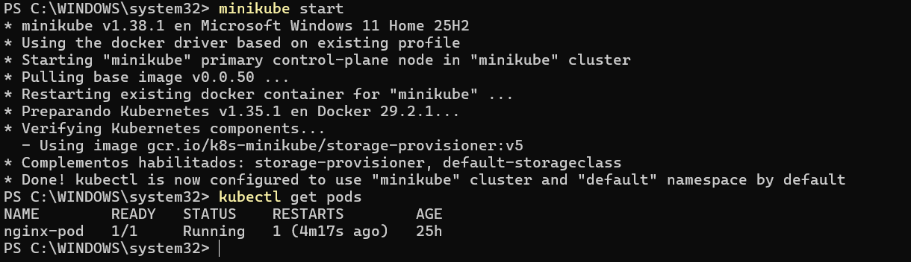
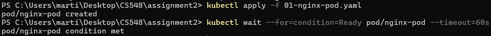
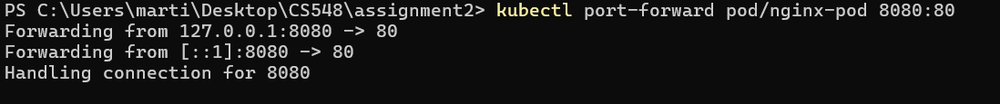
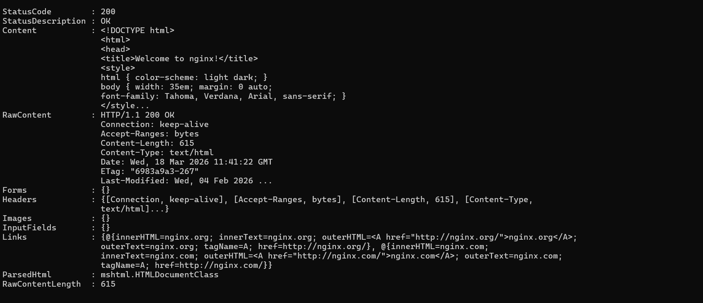
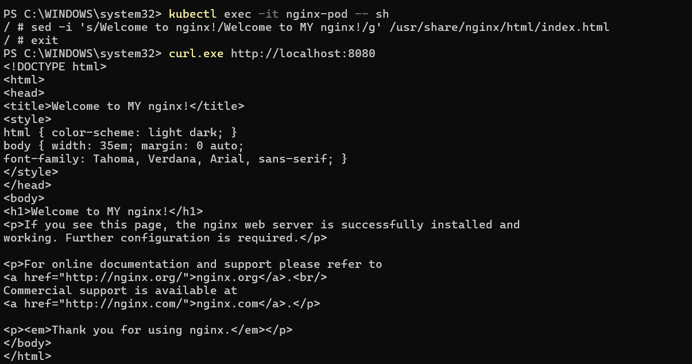
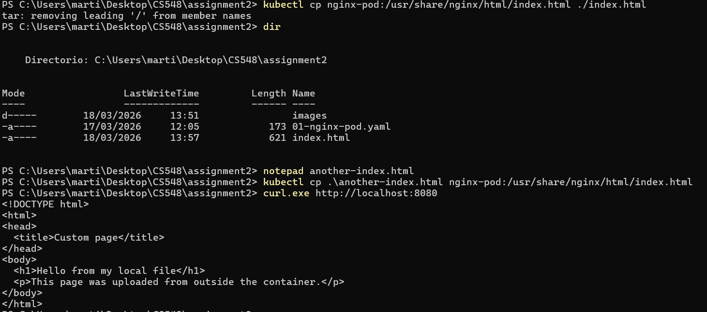
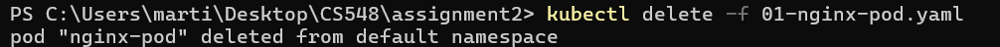


---

## Exercise 2 — Jobs, Volumes and Init Containers

### Create shared volume + nginx

```bash
kubectl apply -f 03-shared-site.yaml
kubectl get pods
```

### Validation

```bash
kubectl port-forward nginx-shared 8081:80
curl http://localhost:8081
```

---

### CronJob to refresh content

```bash
kubectl apply -f 02-job.yaml
kubectl get cronjobs
kubectl get jobs
```

---

### Deployment with Init Container

```bash
kubectl apply -f 04-deployment-init.yaml
kubectl get pods
kubectl rollout status deployment/nginx-site
```

### Logs

Init container:

```bash
kubectl logs <pod-name> -c initial-download
```

Nginx:

```bash
kubectl logs <pod-name> -c nginx
```

---

### Validation

```bash
kubectl port-forward deployment/nginx-site 8082:80
curl http://localhost:8082
```

The site `csd.uoc.gr` was downloaded and served correctly.

---

Data is communicated between containers using a shared volume. Both the init container and the Nginx container mount the same volume. The init container downloads the website content into the shared volume, and then the Nginx container serves those files. This allows containers to exchange data without direct communication.


---


IMAGES:

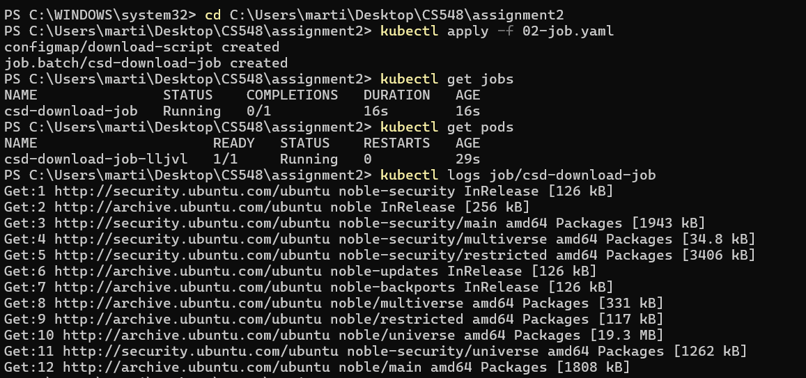

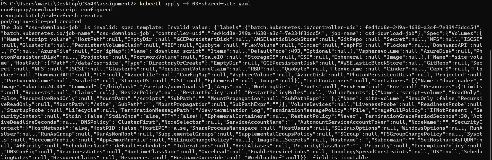
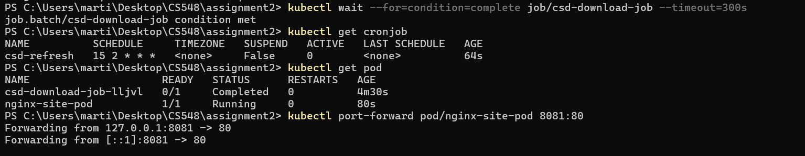
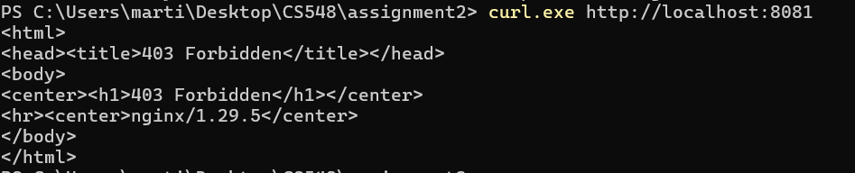
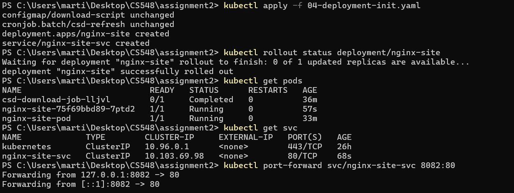
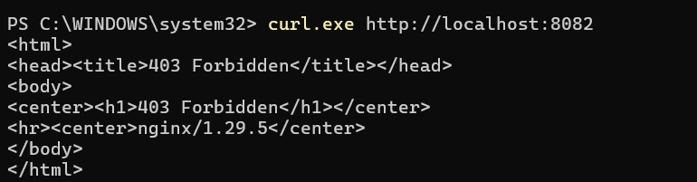
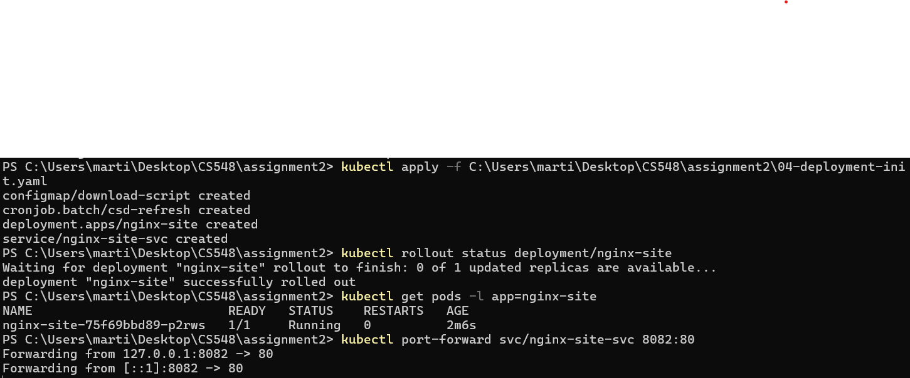
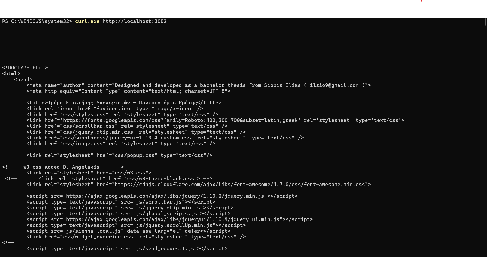

## Exercise 3 — Custom Image, Deployment, Service and Ingress

### Custom Docker Image

#### Dockerfile

```dockerfile
FROM nginx:1.29.5-alpine

RUN apk add --no-cache wget ca-certificates bash

COPY startup.sh /startup.sh
RUN chmod +x /startup.sh

ENV SITE_URL=https://www.csd.uoc.gr/

ENTRYPOINT ["/startup.sh"]
```
---

#### startup.sh

```sh
#!/bin/sh
set -e

TARGET_DIR="/usr/share/nginx/html"

rm -rf "${TARGET_DIR:?}"/*
mkdir -p "$TARGET_DIR"
cd /tmp

wget -E -k -p "$SITE_URL"

HOST_DIR="$(echo "$SITE_URL" | sed -E 's#https?://##' | sed 's#/$##')"

if [ -d "/tmp/$HOST_DIR" ]; then
  cp -r /tmp/"$HOST_DIR"/* "$TARGET_DIR"/
fi

chmod -R 755 "$TARGET_DIR"

exec nginx -g 'daemon off;'
```

---

### Build and Push

```bash
docker build -t davidmr4/nginx-site-downloader:1.0 .
docker login
docker push davidmr4/nginx-site-downloader:1.0
```

---

### Deployment + Service (csd.uoc.gr)

```yaml
apiVersion: apps/v1
kind: Deployment
metadata:
  name: csd-deployment
spec:
  replicas: 2
  selector:
    matchLabels:
      app: csd
  template:
    metadata:
      labels:
        app: csd
    spec:
      containers:
        - name: nginx
          image: davidmr4/nginx-site-downloader:1.0
          env:
            - name: SITE_URL
              value: "https://www.csd.uoc.gr/"
          ports:
            - containerPort: 80
---
apiVersion: v1
kind: Service
metadata:
  name: csd-service
spec:
  type: NodePort
  selector:
    app: csd
  ports:
    - port: 80
      targetPort: 80
      nodePort: 30007
```

---

### Validation

```bash
kubectl apply -f csd.yaml
kubectl get pods
kubectl get svc
minikube service csd-service
```

---

### Second Deployment + Ingress

```yaml
apiVersion: apps/v1
kind: Deployment
metadata:
  name: csd-deployment
spec:
  replicas: 2
  selector:
    matchLabels:
      app: csd
  template:
    metadata:
      labels:
        app: csd
    spec:
      containers:
        - name: nginx
          image: davidmr4/nginx-site-downloader:1.0
          env:
            - name: SITE_URL
              value: "https://www.csd.uoc.gr/"
          ports:
            - containerPort: 80
---
apiVersion: v1
kind: Service
metadata:
  name: csd-service
spec:
  selector:
    app: csd
  ports:
    - port: 80
      targetPort: 80
---
apiVersion: apps/v1
kind: Deployment
metadata:
  name: math-deployment
spec:
  replicas: 2
  selector:
    matchLabels:
      app: math
  template:
    metadata:
      labels:
        app: math
    spec:
      containers:
        - name: nginx
          image: davidmr4/nginx-site-downloader:1.0
          env:
            - name: SITE_URL
              value: "https://math.uoc.gr/"
          ports:
            - containerPort: 80
---
apiVersion: v1
kind: Service
metadata:
  name: math-service
spec:
  selector:
    app: math
  ports:
    - port: 80
      targetPort: 80
---
apiVersion: networking.k8s.io/v1
kind: Ingress
metadata:
  name: university-ingress
  annotations:
    nginx.ingress.kubernetes.io/use-regex: "true"
    nginx.ingress.kubernetes.io/rewrite-target: /$2
spec:
  ingressClassName: nginx
  rules:
    - http:
        paths:
          - path: /csd(/|$)(.*)
            pathType: ImplementationSpecific
            backend:
              service:
                name: csd-service
                port:
                  number: 80
          - path: /math(/|$)(.*)
            pathType: ImplementationSpecific
            backend:
              service:
                name: math-service
                port:
                  number: 80
```

---

### Final Validation

```bash
minikube addons enable ingress
kubectl apply -f ingress-two-sites.yaml
kubectl get pods
kubectl get svc
kubectl get ingress
minikube tunnel
```

Test:

```bash
curl http://127.0.0.1/csd/
curl http://127.0.0.1/math/
```

Both routes correctly serve:

* `/csd` → csd.uoc.gr
* `/math` → math.uoc.gr

---


IMAGES:

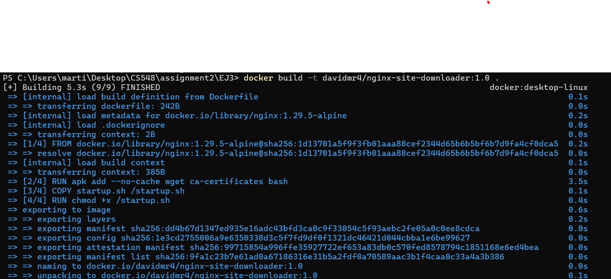
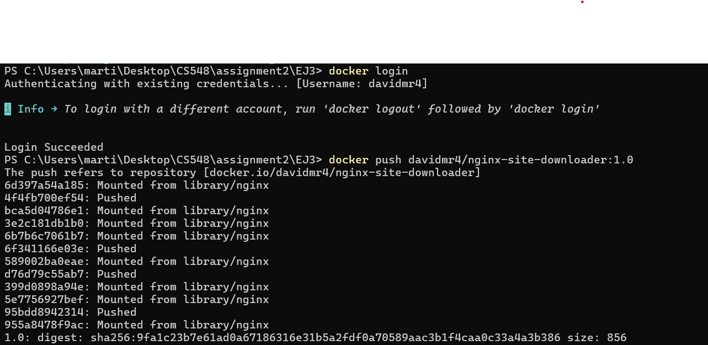

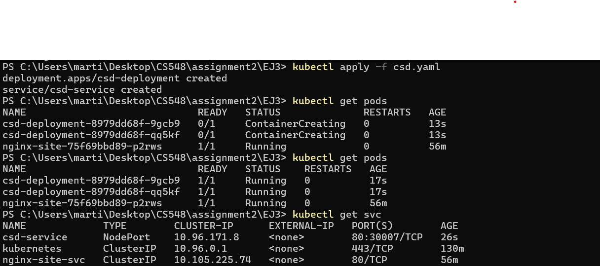
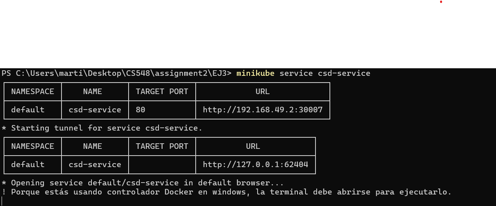
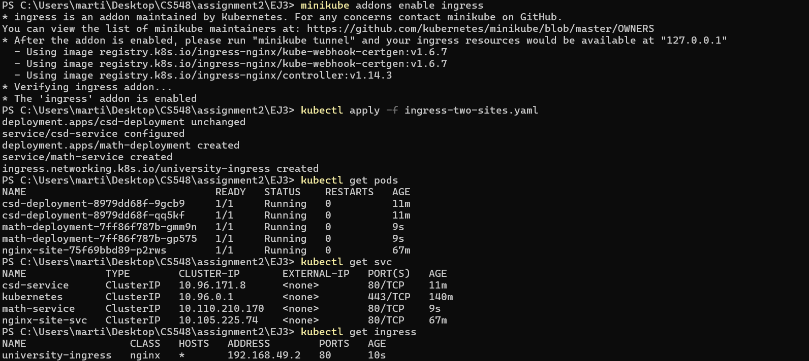


## Conclusion

This assignment demonstrates:

* Basic Pod deployment and interaction
* Use of volumes, Jobs, CronJobs and init containers
* Creation of a custom Docker image
* Deployment scaling with Kubernetes
* Routing with Ingress

