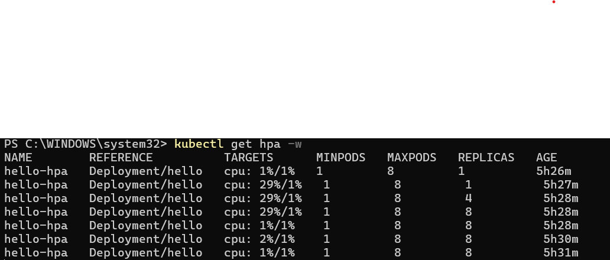
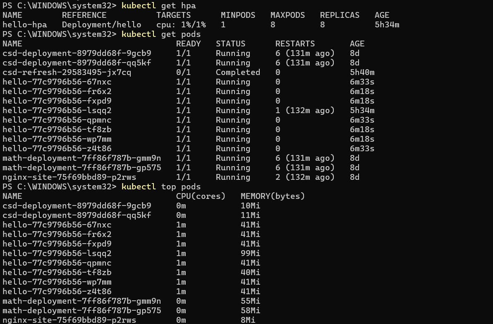
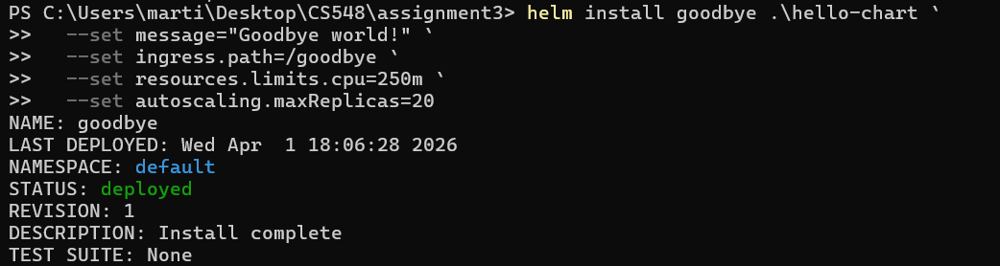
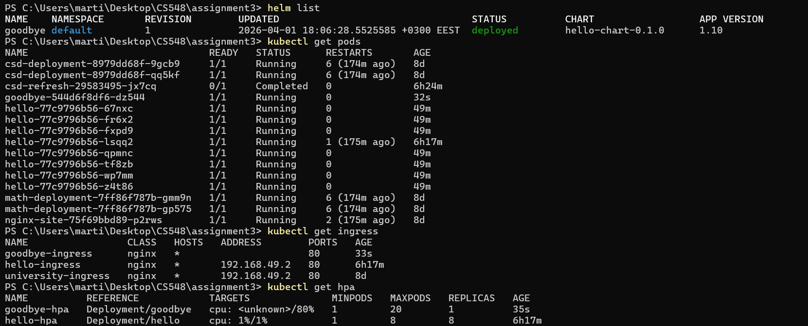
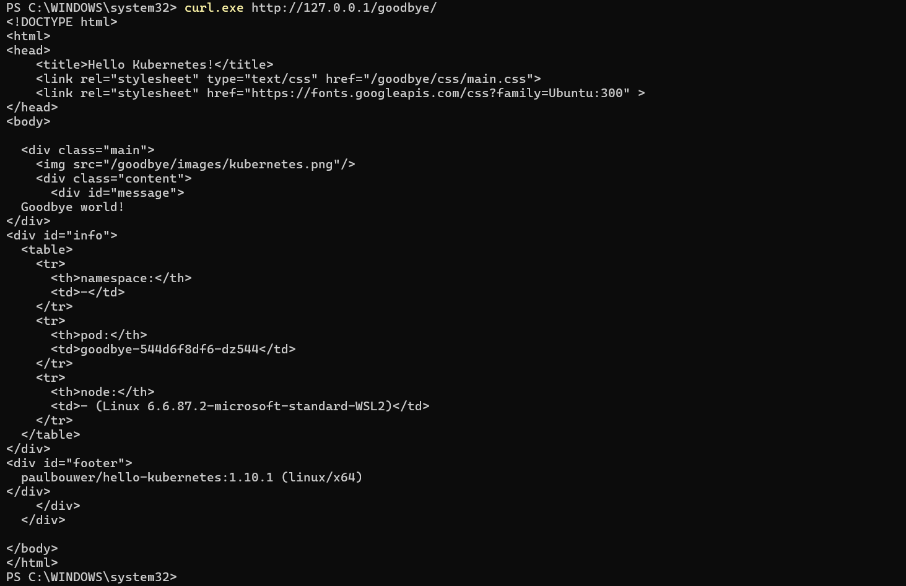
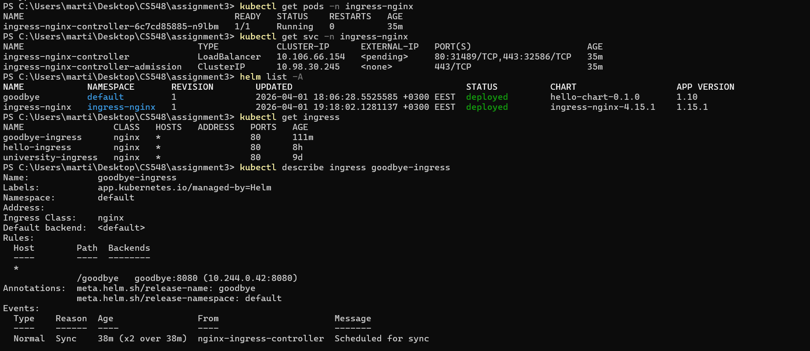

# Assignment 3 — Autoscaler, Helm

**CS-548: Cloud-native Software Architectures**


Name: David Martínez Romero

---

# Exercise 1 — Horizontal Pod Autoscaler

## 1. Introduction

In this exercise the provided "hello world" Kubernetes service was extended by adding resource limits and a HorizontalPodAutoscaler. The goal was to automatically scale the number of Pods based on CPU utilization.

---

## 2. Configuration

The Deployment was modified to include resource limits:

* CPU limit: 200m (20% of a CPU core)
* Memory limit: 256Mi

A HorizontalPodAutoscaler was added with:

* Minimum replicas: 1
* Maximum replicas: 8
* Target CPU utilization: 80%

---

## 3. Deployment

Commands used:

```bash
minikube start
minikube addons enable metrics-server

kubectl apply -f hello-autoscaled.yaml

kubectl get pods
kubectl get hpa
kubectl get ingress
```

To access the service:

```bash
minikube tunnel
curl http://127.0.0.1/hello/
```

---

## 4. Load Testing

A load test was performed using PowerShell:

```powershell
1..100 | ForEach-Object {
    Start-Job { Invoke-WebRequest http://127.0.0.1/hello/ -UseBasicParsing | Out-Null }
}
Get-Job | Wait-Job
Get-Job | Remove-Job
```

Monitoring autoscaling:

```bash
kubectl get hpa -w
```

---

## 5. Results

During the load test:

* CPU usage increased
* The HPA scaled the Deployment automatically
* The number of Pods increased from 1 to 8

Scaling stopped at:

> **8 Pods (maxReplicas)**

---
IMAGES:





## 6. Conclusion

The HorizontalPodAutoscaler successfully adjusted the number of Pods based on system load. The system demonstrated automatic scaling and proper load distribution.

---

# Exercise 2 — Helm Chart

## 1. Introduction

A Helm chart was created to deploy a configurable version of the service. This allows dynamic configuration without modifying YAML files manually.

---

## 2. Chart Structure

```text
hello-chart/
  Chart.yaml
  values.yaml
  templates/
    deployment.yaml
    service.yaml
    ingress.yaml
    hpa.yaml
    _helpers.tpl
```

---

## 3. Configurable Parameters

The Helm chart supports:

* Message (`MESSAGE`)
* Endpoint path (`/hello`, `/goodbye`)
* Resource limits (CPU, memory)
* Autoscaling settings (max replicas)

---

## 4. Installation

The following command was used:

```bash
helm install goodbye ./hello-chart \
  --set message="Goodbye world!" \
  --set ingress.path=/goodbye \
  --set resources.limits.cpu=250m \
  --set autoscaling.maxReplicas=20
```

---

## 5. Configuration Used

* Message: **"Goodbye world!"**
* Endpoint: **/goodbye**
* CPU limit: **250m**
* Memory limit: not set
* Max replicas: **20**

---

## 6. Verification

```bash
helm list
kubectl get pods
kubectl get ingress
kubectl get hpa
```

All resources were successfully deployed.

---

IMAGES:





## 7. Conclusion

Helm simplifies deployment by abstracting configuration into reusable templates and values. This allows flexible and scalable deployments.

---

# Exercise 3 — NGINX Ingress Controller with Helm

## 1. Disable Minikube Ingress Addon

```bash
minikube addons disable ingress
```

---

## 2. Install NGINX Ingress Controller

```bash
helm repo add ingress-nginx https://kubernetes.github.io/ingress-nginx
helm repo update

helm install ingress-nginx ingress-nginx/ingress-nginx \
  --namespace ingress-nginx \
  --create-namespace \
  --wait \
  --timeout 10m
```

---

## 3. Verification

```bash
kubectl get pods -n ingress-nginx
kubectl get svc -n ingress-nginx
helm list -A
```

The controller was successfully deployed and running.

---

## 4. Testing Existing Services

Previously deployed services (e.g., `goodbye`) were tested again using the new ingress controller:

```bash
kubectl get ingress
kubectl describe ingress goodbye-ingress
```

---

## 5. Required Changes in YAML

The only required change was specifying:

```yaml
spec:
  ingressClassName: nginx
```

No changes were required for:

* Deployment
* Service
* HorizontalPodAutoscaler

---

IMAGES:



## 6. Conclusion

The built-in Minikube ingress addon was successfully replaced with the NGINX Ingress Controller installed via Helm. The application continued to work correctly with minimal changes.

---

# Final Conclusion

This assignment demonstrated:

* Automatic scaling using HorizontalPodAutoscaler
* Application deployment using Helm charts
* Managing ingress traffic using NGINX Ingress Controller

These tools are fundamental for building scalable, cloud-native applications in Kubernetes.

---
