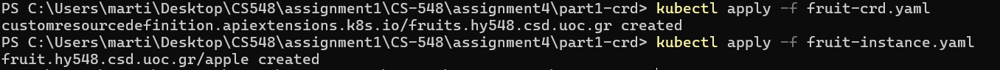
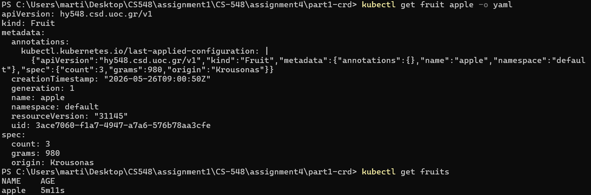
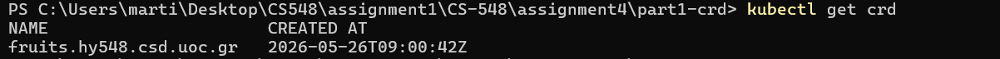
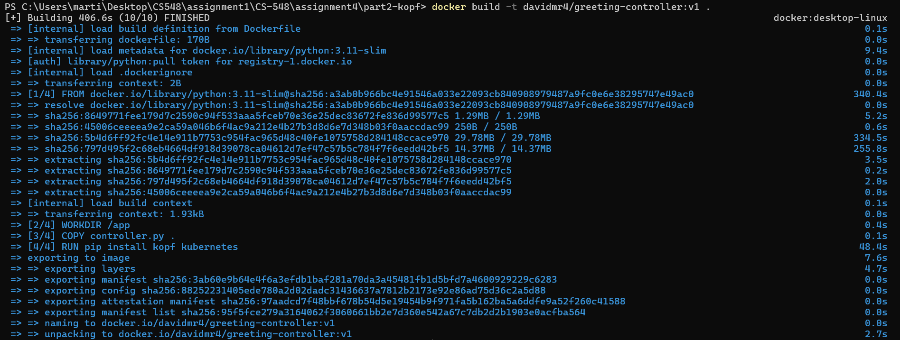
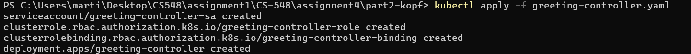
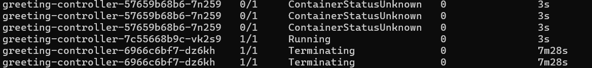
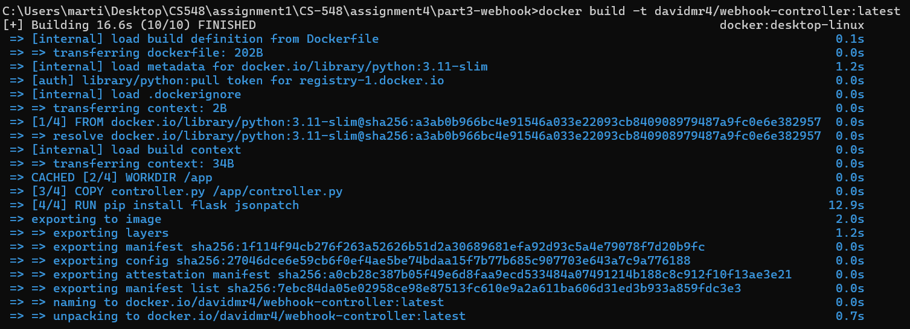
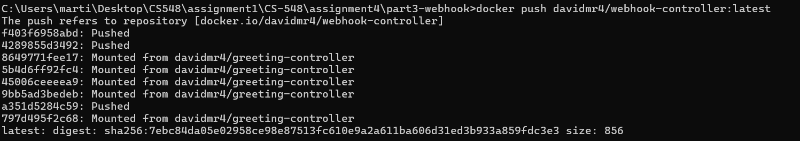
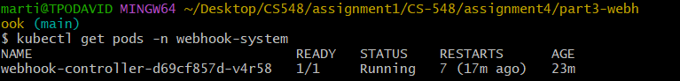

**CS-548: Cloud-native Software Architectures**

NAME: DAVID MARTINEZ ROMERO

# Assignment 4: Extending

## Part 1: Custom Resource Definition (Fruit)

This section defines and manages a custom Kubernetes resource called `Fruit`.

### CRD YAML (`fruit-crd.yaml`)

```yaml
apiVersion: apiextensions.k8s.io/v1
kind: CustomResourceDefinition
metadata:
  name: fruits.hy548.csd.uoc.gr
spec:
  group: hy548.csd.uoc.gr
  versions:
    - name: v1
      served: true
      storage: true
      schema:
        openAPIV3Schema:
          type: object
          properties:
            spec:
              type: object
              properties:
                origin:
                  type: string
                count:
                  type: integer
                grams:
                  type: integer
  scope: Namespaced
  names:
    plural: fruits
    singular: fruit
    kind: Fruit
    shortNames:
      - fr
```

### Example instance (`apple.yaml`)

```yaml
apiVersion: hy548.csd.uoc.gr/v1
kind: Fruit
metadata:
  name: apple
spec:
  origin: Krousonas
  count: 3
  grams: 980
```

### kubectl commands

**1. Install the CRD:**
```bash
kubectl apply -f fruit-crd.yaml
```

**2. Create the instance:**
```bash
kubectl apply -f apple.yaml
```

**3. Return the instance in YAML format:**
```bash
kubectl get fruit apple -o yaml
```

**4. List all available instances:**
```bash
kubectl get fruits
```

IMAGES:






---

## Part 2: Kopf CRD Controller

### What was implemented

A custom Kubernetes controller was built using the Python Kopf library. It watches for `Greeting` custom resources and automatically creates a corresponding Deployment and Service running the `hello-kubernetes` container.

### Files

**`controller.py`** — Kopf operator that handles `Greeting` CRD creation events and creates a Deployment and Service from a Jinja2 template.

**`Dockerfile`**:
```dockerfile
FROM python:3.11-slim

WORKDIR /app

COPY controller.py .

RUN pip install kopf kubernetes jinja2

CMD ["kopf", "run", "--standalone", "--all-namespaces", "/app/controller.py"]
```

The image was built and pushed to Docker Hub as `davidmr4/greeting-controller:v5`.

**`greeting-controller.yaml`** — Creates a ServiceAccount, ClusterRole, ClusterRoleBinding, and Deployment for the controller.

The ClusterRole grants permissions to:
- Read `Greeting` CRDs (`hy548.csd.uoc.gr`)
- Create/manage Deployments (`apps`)
- Create/manage Services and Events (core API)
- Manage Leases (`coordination.k8s.io`) for Kopf internals
- Access non-resource URLs `/api` and `/apis` for resource discovery

### Commands used

```bash
# Build and push the image
docker build -t davidmr4/greeting-controller:v5 .
docker push davidmr4/greeting-controller:v5

# Load into Minikube (required due to Docker Hub network issues from Minikube)
minikube image load davidmr4/greeting-controller:v5

# Deploy the controller
kubectl apply -f greeting-controller.yaml

# Verify the pod is running
kubectl get pods -l app=greeting-controller

# Check logs
kubectl logs -f deployment/greeting-controller
```

### Issue encountered

The controller pod starts successfully but Kopf fails to authenticate against the Kubernetes API, receiving `403 Forbidden` as `system:anonymous` when trying to reach `/api` and `/apis`, even though the ServiceAccount token is correctly mounted at `/var/run/secrets/kubernetes.io/serviceaccount/token`.

This appears to be a known issue with Kopf's internal `aiohttp` HTTP client not picking up the ServiceAccount token in Minikube. The RBAC permissions are correctly configured including `nonResourceURLs` for `/api` and `/apis`.


IMAGES:






---

## Part 3: Kubernetes Admission Webhook

### What was implemented

A Mutating Admission Webhook was implemented using Python (Flask). It exposes a `/mutate` endpoint that intercepts Pod creation requests and injects a custom label into the Pod metadata using JSONPatch.

### Files

**`controller.py`** — Flask application exposing `/mutate`. It reads the `AdmissionReview` request, injects a label defined by the `CUSTOM_LABEL` environment variable, and returns a base64-encoded JSONPatch response.

**`Dockerfile`**:
```dockerfile
FROM python:3.11-slim

WORKDIR /app

COPY controller.py .

RUN pip install flask jsonpatch

EXPOSE 8000

CMD ["python", "controller.py"]
```

The image was built and pushed to Docker Hub as `davidmr4/webhook-controller:latest`.

**`webhook.yaml`** — Creates a Namespace, Deployment, Service, and MutatingWebhookConfiguration. TLS certificates are mounted via a Kubernetes Secret (`webhook-tls`).

### TLS certificate generation

A self-signed certificate was generated with the correct SANs for the in-cluster service DNS name:

```bash
openssl req -x509 -newkey rsa:2048 -keyout tls.key -out tls.crt -days 365 -nodes \
  -config openssl.cnf
```

The certificate uses `subjectAltName` with:
- `webhook-service`
- `webhook-service.webhook-system`
- `webhook-service.webhook-system.svc`

The TLS secret was created with:
```bash
kubectl create secret tls webhook-tls \
  --cert=tls.crt \
  --key=tls.key \
  -n webhook-system
```

The `caBundle` field in the `MutatingWebhookConfiguration` was populated with the base64-encoded certificate:
```bash
cat tls.crt | base64 -w 0
```

### Commands used to verify

```bash
# Deploy the webhook
kubectl apply -f webhook.yaml

# Verify the pod is running
kubectl get pods -n webhook-system

# Test by creating a pod — the webhook should intercept it
kubectl run test --image=nginx

# Verify the label was injected
kubectl get pod test -o jsonpath='{.metadata.labels}'
```

### Issue encountered

When testing the webhook, the following error appeared:

```
failed to call webhook: Post "https://webhook-service.webhook-system.svc:443/mutate":
tls: failed to verify certificate: x509: certificate relies on legacy Common Name field,
use SANs instead
```

This happened because the initial TLS certificate used only the `CN` (Common Name) field for the hostname. Modern versions of Go (used by Kubernetes) require the `subjectAltName` (SAN) extension instead. The certificate was regenerated using an `openssl.cnf` config file that explicitly sets the SANs, which resolved the issue.

IMAGES:





# Assignment 4: Extending

## Part 1: Custom Resource Definition (Fruit)

This section defines and manages a custom Kubernetes resource called `Fruit`.

### CRD YAML (`fruit-crd.yaml`)

```yaml
apiVersion: apiextensions.k8s.io/v1
kind: CustomResourceDefinition
metadata:
  name: fruits.hy548.csd.uoc.gr
spec:
  group: hy548.csd.uoc.gr
  versions:
    - name: v1
      served: true
      storage: true
      schema:
        openAPIV3Schema:
          type: object
          properties:
            spec:
              type: object
              properties:
                origin:
                  type: string
                count:
                  type: integer
                grams:
                  type: integer
  scope: Namespaced
  names:
    plural: fruits
    singular: fruit
    kind: Fruit
    shortNames:
      - fr
```

### Example instance (`apple.yaml`)

```yaml
apiVersion: hy548.csd.uoc.gr/v1
kind: Fruit
metadata:
  name: apple
spec:
  origin: Krousonas
  count: 3
  grams: 980
```

### kubectl commands

**1. Install the CRD:**
```bash
kubectl apply -f fruit-crd.yaml
```

**2. Create the instance:**
```bash
kubectl apply -f apple.yaml
```

**3. Return the instance in YAML format:**
```bash
kubectl get fruit apple -o yaml
```

**4. List all available instances:**
```bash
kubectl get fruits
```

---

## Part 2: Kopf CRD Controller

### What was implemented

A custom Kubernetes controller was built using the Python Kopf library. It watches for `Greeting` custom resources and automatically creates a corresponding Deployment and Service running the `hello-kubernetes` container.

### Files

**`controller.py`** — Kopf operator that handles `Greeting` CRD creation events and creates a Deployment and Service from a Jinja2 template.

**`Dockerfile`**:
```dockerfile
FROM python:3.11-slim

WORKDIR /app

COPY controller.py .

RUN pip install kopf kubernetes jinja2

CMD ["kopf", "run", "--standalone", "--all-namespaces", "/app/controller.py"]
```

The image was built and pushed to Docker Hub as `davidmr4/greeting-controller:v5`.

**`greeting-controller.yaml`** — Creates a ServiceAccount, ClusterRole, ClusterRoleBinding, and Deployment for the controller.

The ClusterRole grants permissions to:
- Read `Greeting` CRDs (`hy548.csd.uoc.gr`)
- Create/manage Deployments (`apps`)
- Create/manage Services and Events (core API)
- Manage Leases (`coordination.k8s.io`) for Kopf internals
- Access non-resource URLs `/api` and `/apis` for resource discovery

### Commands used

```bash
# Build and push the image
docker build -t davidmr4/greeting-controller:v5 .
docker push davidmr4/greeting-controller:v5

# Load into Minikube (required due to Docker Hub network issues from Minikube)
minikube image load davidmr4/greeting-controller:v5

# Deploy the controller
kubectl apply -f greeting-controller.yaml

# Verify the pod is running
kubectl get pods -l app=greeting-controller

# Check logs
kubectl logs -f deployment/greeting-controller
```

### Issue encountered

The controller pod starts successfully but Kopf fails to authenticate against the Kubernetes API, receiving `403 Forbidden` as `system:anonymous` when trying to reach `/api` and `/apis`, even though the ServiceAccount token is correctly mounted at `/var/run/secrets/kubernetes.io/serviceaccount/token`.

This appears to be a known issue with Kopf's internal `aiohttp` HTTP client not picking up the ServiceAccount token in Minikube. The RBAC permissions are correctly configured including `nonResourceURLs` for `/api` and `/apis`.

---

## Part 3: Kubernetes Admission Webhook

### What was implemented

A Mutating Admission Webhook was implemented using Python (Flask). It exposes a `/mutate` endpoint that intercepts Pod creation requests and injects a custom label into the Pod metadata using JSONPatch.

### Files

**`controller.py`** — Flask application exposing `/mutate`. It reads the `AdmissionReview` request, injects a label defined by the `CUSTOM_LABEL` environment variable, and returns a base64-encoded JSONPatch response.

**`Dockerfile`**:
```dockerfile
FROM python:3.11-slim

WORKDIR /app

COPY controller.py .

RUN pip install flask jsonpatch

EXPOSE 8000

CMD ["python", "controller.py"]
```

The image was built and pushed to Docker Hub as `davidmr4/webhook-controller:latest`.

**`webhook.yaml`** — Creates a Namespace, Deployment, Service, and MutatingWebhookConfiguration. TLS certificates are mounted via a Kubernetes Secret (`webhook-tls`).

### TLS certificate generation

A self-signed certificate was generated with the correct SANs for the in-cluster service DNS name:

```bash
openssl req -x509 -newkey rsa:2048 -keyout tls.key -out tls.crt -days 365 -nodes \
  -config openssl.cnf
```

The certificate uses `subjectAltName` with:
- `webhook-service`
- `webhook-service.webhook-system`
- `webhook-service.webhook-system.svc`

The TLS secret was created with:
```bash
kubectl create secret tls webhook-tls \
  --cert=tls.crt \
  --key=tls.key \
  -n webhook-system
```

The `caBundle` field in the `MutatingWebhookConfiguration` was populated with the base64-encoded certificate:
```bash
cat tls.crt | base64 -w 0
```

### Commands used to verify

```bash
# Deploy the webhook
kubectl apply -f webhook.yaml

# Verify the pod is running
kubectl get pods -n webhook-system

# Test by creating a pod — the webhook should intercept it
kubectl run test --image=nginx

# Verify the label was injected
kubectl get pod test -o jsonpath='{.metadata.labels}'
```

### Issue encountered

When testing the webhook, the following error appeared:

```
failed to call webhook: Post "https://webhook-service.webhook-system.svc:443/mutate":
tls: failed to verify certificate: x509: certificate relies on legacy Common Name field,
use SANs instead
```

This happened because the initial TLS certificate used only the `CN` (Common Name) field for the hostname. Modern versions of Go (used by Kubernetes) require the `subjectAltName` (SAN) extension instead. The certificate was regenerated using an `openssl.cnf` config file that explicitly sets the SANs, which resolved the issue.

---

## Conclusion

This assignment covered three ways to extend Kubernetes: defining custom resource types with CRDs, building operators with Kopf to react to those resources, and intercepting API requests with admission webhooks. The main challenges encountered were related to in-cluster authentication with Kopf and TLS certificate configuration for the webhook, both of which are common pain points when moving from local development to a real cluster environment.